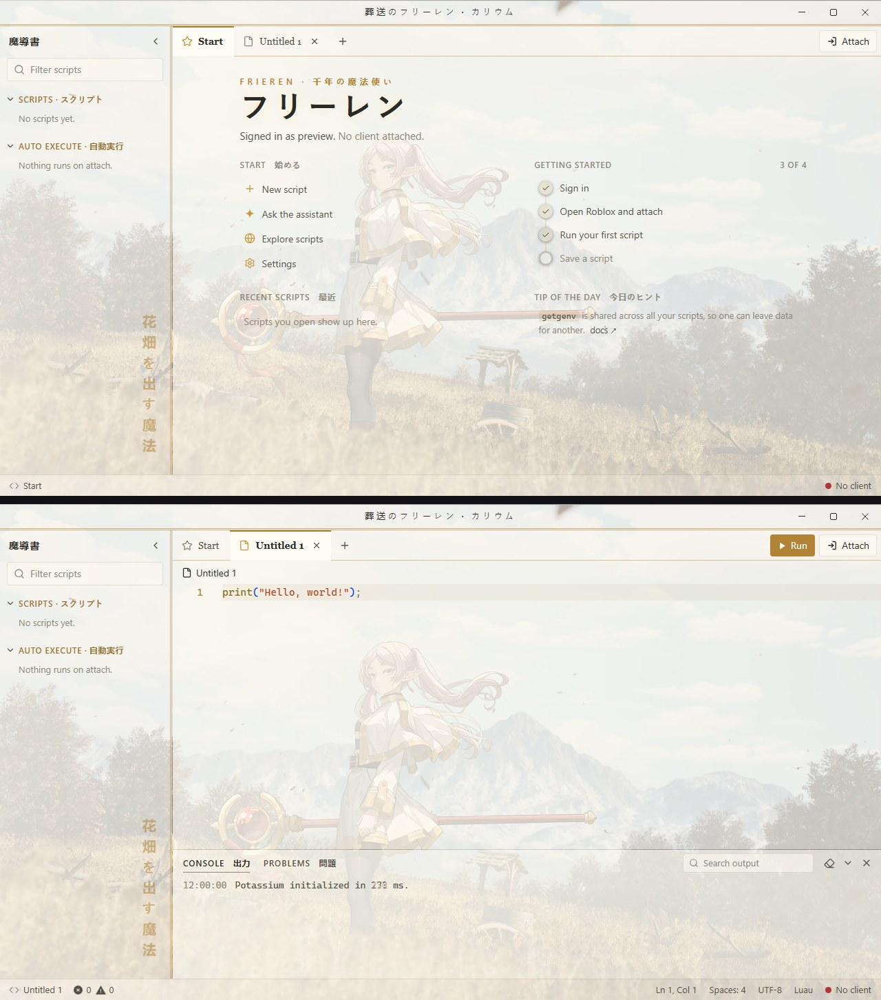
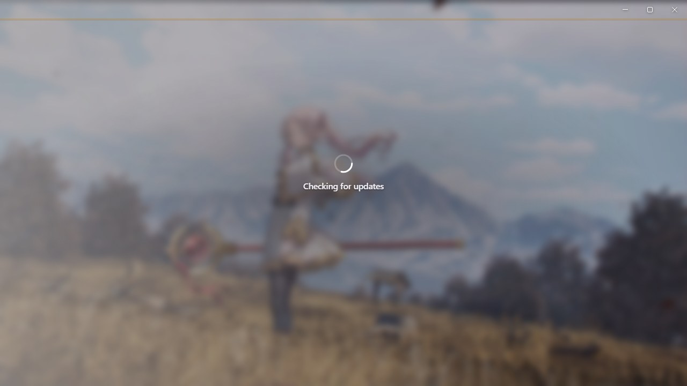

# Frieren theme for Potassium

An animated Frieren: Beyond Journey's End theme for the Potassium executor. Parchment and gold over a sunny meadow, with serif type and gilded rules. A looping wallpaper plays behind the whole app, and the labels are in Japanese.

Previews are animated (AVIF) and show the Start page, a script tab and the loading screen at full size. Browsers that can't play AVIF show a still screenshot instead.

<picture>
  <source srcset="screens.avif" type="image/avif">
  
</picture>

<picture>
  <source srcset="loading.avif" type="image/avif">
  
</picture>

## Install

1. In Potassium, open **Settings → Appearance → Custom theme**.
2. Set **Base theme** to **Light**. The editor's syntax colours come from the base theme.
3. Copy everything in [`Theme.css`](Theme.css) and paste it into **Custom CSS**.
4. Type a name under **Save** and click **Save**.

## Loading screen

The theme also replaces Potassium's own loading and login picture with its wallpaper, softly blurred, so the theme starts the moment the app opens (shown above, under the main preview).

## What the Japanese means

| Text | Reading | Meaning |
|---|---|---|
| 葬送のフリーレン | Sōsō no Furīren | Frieren: Beyond Journey's End (title bar) |
| 魔導書 | madōsho | Grimoire (explorer) |
| 千年の魔法使い | sennen no mahōtsukai | The thousand-year-old mage |
| フリーレン | Furīren | Frieren |
| 花畑を出す魔法 | hanabatake o dasu mahō | The spell that makes a field of flowers, her favourite |

The theme also translates Potassium's own labels:

| Text | Reading | Meaning |
|---|---|---|
| カリウム | karyūmu | Potassium |
| スクリプト | sukuriputo | Scripts |
| 自動実行 | jidō jikkō | Auto execute |
| 出力 | shutsuryoku | Output (console) |
| 問題 | mondai | Problems |
| 始める | hajimeru | Start |
| 最近 | saikin | Recent |
| 今日のヒント | kyō no hinto | Tip of the day |

## Notes

- Wallpapers are animated AVIF files loaded from this repo, so you need internet the first time. If a wallpaper can't load, the colours still apply.
- Potassium cuts custom CSS off at 50,000 characters. This theme is about 6,500, so there's room for your own tweaks.
- The layouts target Potassium's internal class names. A future Potassium update could rename them; if that happens, the colours keep working but some layout touches may not.

## Credits

Frieren: Beyond Journey's End belongs to Kanehito Yamada, Tsukasa Abe, Shogakukan and Madhouse. The wallpaper is converted from a live wallpaper posted on [WallpaperWaifu](https://wallpaperwaifu.com):
[Frieren](https://wallpaperwaifu.com/anime/frieren-sousou-no-frieren-live-wallpaper-2245/).
